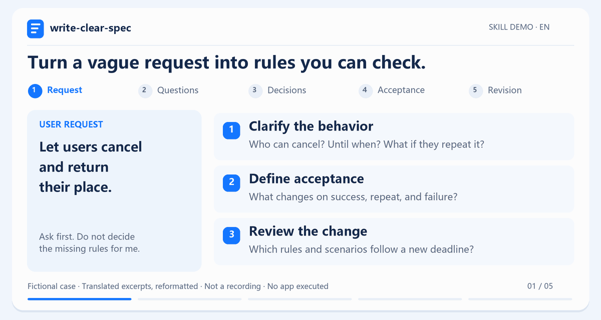

<div align="center">


<h1>Write Clear Spec</h1>

**Clear specs before AI writes code.**

An Agent Skill for turning rough ideas into clear requirements, finding missing decisions, and keeping changes consistent.

[](SKILL.md) [](LICENSE) [](SKILL.md)

[Demo](#demo) · [Quickstart](#quickstart) · [Feedback](https://github.com/yiyiwahmo28-hue/write-clear-spec/issues) · English · [简体中文](README.zh-CN.md)

</div>

## Demo

<div align="center">



*Fictional example. Translated excerpts from an actual Skill conversation, reformatted; not a screen recording.*

[Full original conversation](docs/demo.md) · [Static version](docs/assets/demo-en.png)

</div>

For product managers, designers, and builders working with AI. Start with an idea, a draft, or a rule change.

## Quickstart

Install with the [Skills CLI](https://github.com/vercel-labs/skills), then select your assistant:

```sh
npx skills add yiyiwahmo28-hue/write-clear-spec --skill write-clear-spec
```

In an assistant that supports named Skill invocation, copy this request:

```text
Use $write-clear-spec to clarify this requirement:
“Support registration cancellation and release the reserved place after cancellation.”
Ask the key questions first. Do not decide the rules for me.
```

**Try it without installing the Skill:** give your assistant the contents of [SKILL.md](SKILL.md) and the same requirement. For deeper reviews, also make the required [reference files](references/) available.

<details>
<summary>Installer requirements and manual setup</summary>

The Skills CLI installer requires Node.js and npm. The Skill itself is a folder of instructions with no executable dependency or external service of its own. It uses your assistant's model and authorized file access.

For manual setup, download this repository, name its folder `write-clear-spec`, and place it in a Skill directory supported by your assistant. Keep `SKILL.md`, `references/`, and `agents/` together.

</details>

## Features

Choose the focus that fits the task; these approaches can be used together.

| Task | Focus |
| --- | --- |
| Copyediting | Clear wording and readable sentences |
| Fixed document template | Consistent structure and sections |
| This Skill | Behavior rules, open decisions, and consistency after changes |

The Skill drafts, reviews, or revises requirements in your language and format. Confirmed decisions, open questions, and optional suggestions stay separate.

## Documentation

- [Skill instructions](SKILL.md) — the draft, review, and revise workflow.
- [Review guide](references/review-guide.md) — evidence, consistency, and verification.
- [Worked examples (中文)](references/examples.md) — missing decisions, concrete requirements, and scoped changes.

<details>
<summary>Separate fictional example: cancellation and admin exports</summary>

### “Support registration cancellation and release the reserved place.”

*This standalone fictional example includes admin-export rules confirmed by its fictional user. It is separate from the conversation shown in the Demo.*

**The skill asks:**

- When is cancellation allowed?
- What happens if the same registration is canceled twice, or cancellation fails?
- Should a canceled registration still appear in the active list?

**The user confirms:** cancellation is allowed before the registration deadline. Success immediately returns one place and removes the registration from the active list. Admin exports include active registrations only. Repeated cancellation releases no additional place; failure changes neither the registration nor capacity.

**The resulting requirements make the consequences explicit:**

- Successful cancellation decreases the active count by one, frees one place, and excludes the registration from the active-registration export.
- Canceling that same registration again does not free another place.
- Failed cancellation preserves the registration's pre-operation status and remaining capacity.

**Acceptance scenario and open decisions**

Before the deadline, start with a full event and cancel one active registration. Exactly one place should become available. Repeat the cancellation: available places must not increase again. Check that the canceled registration is absent from the active count and export.

Behavior at the exact deadline and success/failure messages still need a decision. These are expected results to verify; no event application was executed for this example.

The fuller [registration-change example](references/examples.md#示例三需求更新时保留规则并找出关联遗漏) also covers re-registration, remaining capacity, and preserving existing rules.

</details>

## Contributing

Share a small, fictional before/after case in an [issue](https://github.com/yiyiwahmo28-hue/write-clear-spec/issues). Include the input, confirmed decisions, and what the skill missed. Improvements to questions, examples, and wording are welcome.

All instructions and examples were independently written for this skill. Keep contributions free of employer materials, customer data, and internal systems. This project supports specification work; implementation results require actual execution evidence.

## License

[MIT](LICENSE).
